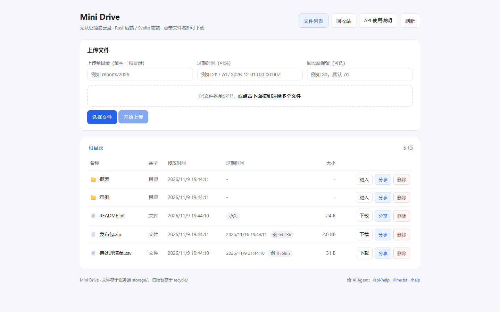

# Mini Drive · 简易云盘

**一个不用登录、专门给 AI Agent 和脚本用的文件中转站。**

上传就是 `PUT` 一个 URL，下载就是 `GET` 同一个 URL；文件按目录原样落在服务器磁盘上，浏览器打开就能看列表、点击下载。没有账号、没有 token、没有数据库。



> 页面预览：目录浏览、批量上传、过期时间设置、文件列表的「过期时间」列与「删除」按钮（截图为演示数据）。

---

## 这个工具是干什么的

AI Agent、定时任务、CI 脚本跑完之后，经常需要把产物（报告、日志、导出数据）交给别人或另一个 Agent，也经常需要取一个输入文件。用真正的网盘要注册、OAuth、装 SDK；用临时图床又只能传图片、不能建目录、没有留存策略。

Mini Drive 只保留这件事最必要的部分：

- **两条 HTTP 请求就够**：任何语言的 HTTP 标准库都能调，不需要 SDK，也不需要任何认证信息。
- **路径就是目录**：`PUT /files/reports/2026/a.pdf` 会生成 `storage/reports/2026/a.pdf`，父目录自动创建，在资源管理器里直接能看到。
- **Agent 能自己学会怎么用**：服务内置了使用说明，只要把一句「先读这个地址」发给 Agent，它就会自己拿到完整接口文档和示例，不用人替它写。
- **临时文件自动收尾**：上传时可以给文件设一个过期时间，到期自动打包进回收站，再过一段时间自动删掉，不留垃圾。

技术实现：后端是 **Rust**（`tiny_http`，单个原生二进制，运行时零依赖），前端是 **Svelte 5 + Vite**（构建成静态资源，由后端直接托管）。前端产物已提交，clone 下来只需编译后端即可运行。

---

## 有什么功能

### 1. 文件存取（核心）

| 能力 | 说明 |
| --- | --- |
| 上传 | `PUT /files/<路径>`（请求体就是文件原始字节，等价 `curl -T`）、`POST /api/upload`、`X-File-Path` 请求头、multipart 多文件，共四种写法 |
| 下载 | `GET /files/<路径>` 或 `GET /api/download?path=`，统一以附件返回，不做预览 |
| 目录 | 支持任意层级子目录，父目录自动创建；`GET /api/list` 可单层查看或 `recursive=1` 递归列出全部；`POST /api/mkdir` 建空目录 |
| 中文路径 | 目录名、文件名支持中文与空格，URL 编码即可，下载时文件名正确回传 |
| 覆盖 | 同名文件直接覆盖，没有版本管理 |
| 删除 | `DELETE /files/<路径>`：把文件（或整个目录）打包成 ZIP 移入回收站并删除原路径，可下载恢复；`DELETE /recycle/<name>.zip` 则彻底删除，不可恢复 |
| 体积 | 单次请求上限默认 200 MB，可用 `MAX_UPLOAD_MB` 调整 |

### 2. 给 AI Agent 的自助说明

服务自带三种说明，**Agent 读一个就能自己完成接入**：

| 地址 | 形式 | 适合 |
| --- | --- | --- |
| `GET /api/help` | JSON，含全部接口、参数、curl / Python 示例、可直接转发的提示词 | Agent 程序解析 |
| `GET /llms.txt` | 纯文本，同样的内容 | 直接贴进上下文 |
| `GET /help` | HTML 页面 | 人看 |

说明里的 `base_url` 会按请求的 Host 头自动生成 —— 从哪台机器访问，示例里就是哪台机器该用的地址。项目根目录还有一份静态版 `llms.txt`，可以离线发给 Agent。

实际接入时，只需要给 Agent 这一句：

```
先读取 http://<服务地址>:8787/llms.txt ，按其说明上传和下载文件。
```

### 3. 浏览器页面

打开 `/` 即用，无需登录：

- **目录浏览**：面包屑导航，点击目录进入、点击文件名或「下载」保存文件；列表的「过期时间」列显示到期时刻与剩余时间（即将到期、已到期会高亮），未设置过期的文件显示「永久」，目录显示「-」。
- **上传**：选择文件或直接拖拽，可指定目标目录，支持一次选多个；可选填「过期时间」和「回收站保留」。
- **分享给 AI**：每一行（目录或文件）后面都有「分享」按钮，点击即复制一段可直接粘贴给 Agent 的提示词 —— 只含服务地址、`/llms.txt` 说明入口、目标路径和一条现成命令，不重复 API 文档。地址按当前访问的域名自动生成（从局域网打开就给局域网地址），中文路径自动编码；浏览器禁用剪贴板时会弹出文本框供手动复制。
- **删除**：每一行（文件或目录）都有「删除」按钮，点击先弹确认框；确认后内容打包成 ZIP 移入回收站，原位置不再可访问，不是直接抹掉。
- **回收站视图**：右上角切换，列出归档压缩包、原文件路径、体积与过期时间，可下载 ZIP 恢复，或点「彻底删除」永久清除（同样有确认框）。
- **帮助入口**：页面内直接跳转 `/help`。

分享按钮复制出来的提示词（以文件为例，5 行）：

```text
Mini Drive 云盘（无需认证）：http://<服务地址>:8787
接口说明：GET http://<服务地址>:8787/llms.txt
目标文件：reports/2026/report.pdf
下载：GET http://<服务地址>:8787/files/reports/2026/report.pdf
请读取该文件并按我的要求处理。
```

目录的提示词同样是 5 行，`下载` 一行换成 `列出：GET .../api/list?path=<目录>&recursive=1`。Agent 拿到 `/llms.txt` 后即可自行掌握上传、列目录等全部接口。

### 4. 文件生命周期（过期归档 → 回收站 → 自动删除）

给临时文件设两道时间，服务会自动收尾：

```
上传（可设 expires） ──到期 / 手动 DELETE──▶ 打成 ZIP、删除原文件、移入 recycle/ ──保留期结束 / 彻底删除──▶ 删除 ZIP
```

| 阶段 | 触发 | 动作 |
| --- | --- | --- |
| ① 过期归档 | 上传时指定的 `expires` 到期 | 该文件打成一个 ZIP（包内保留原目录结构与 UTF-8 文件名），从 `storage/` 删除原文件 |
| ①' 手动删除 | 页面上点「删除」或 `DELETE /files/<路径>` | 立即归档，效果同上；目录会把其中全部文件打进一个 ZIP，包内保留目录结构 |
| ② 回收站清理 | `recycle` / 全局 `RECYCLE_TTL` 到期，或 `DELETE /recycle/<name>.zip` | 删除该 ZIP，不可恢复 |

设时间的三种方式：URL 参数 `?expires=2h&recycle=3d`、请求头 `X-File-Expires` / `X-File-Recycle`、multipart 表单字段。时长支持 `30s` / `10m` / `2h` / `7d` / `4w`，纯数字按秒，`expires` 还支持 ISO 8601 绝对时间。

默认是**保守的**：`DEFAULT_TTL` 留空，不显式设 `expires` 的文件永不自动归档；回收站默认保留 `7d`，每 `60s` 扫描一次。想让所有上传都自动过期，启动时设 `DEFAULT_TTL=24h` 即可。

到期记录持久化在 `lifecycle.json`，**重启不丢**；也可以随时 `POST /api/sweep` 手动触发一次扫描。`GET /api/lifecycle` 查看待归档文件与到期时间，`GET /api/recycle` 查看归档包。

手动删除与彻底删除的 API：

```bash
curl -X DELETE "http://127.0.0.1:8787/files/docs/a.txt"        # 打包进回收站，可恢复
curl -X DELETE "http://127.0.0.1:8787/recycle/<name>.zip"      # 立即永久删除，不可恢复
```

### 5. 部署与安全

- **单二进制**：Rust 编译出一个 exe，运行时不需要 Node、Python 或任何依赖；Windows 下走 `windows-gnu` 工具链，无需装 Visual Studio / MinGW。
- **仅本机 / 局域网一键切换**：默认 `HOST=127.0.0.1`；设 `0.0.0.0` 或双击 `start-lan.bat` 就让局域网里的 Agent 调用。
- **路径防护**：拒绝 `..`、绝对路径、盘符、隐藏文件、Windows 非法字符，并校验不越出 `storage/` / `recycle/` / `public/`。
- **CORS 开放**：方便来自不同来源的 Agent / 网页调用。

### 刻意不做的事

登录与权限、数据库、在线预览、改名、一键还原（回收站只提供 ZIP 下载）、版本管理、分享链接、分片上传 —— 这些都不在这个工具的范围内。页面和 API 只围绕「放进去、列出来、拿出来、删进回收站、到期收走」。

---

## 快速开始

`public/` 已包含构建好的前端产物，只需编译 Rust 后端：

```bash
cd mini-drive
cargo build --release
./target/release/mini-drive          # Windows: target\release\mini-drive.exe
```

打开 <http://127.0.0.1:8787/>。Windows 也可以直接双击 `start.bat`（仅本机）或 `start-lan.bat`（局域网），脚本会在没有编译产物时自动 `cargo run --release`。

修改前端才需要 Node.js 20+：

```bash
cd web && npm install && npm run build && cd ..   # 产物输出到 public/
```

cargo 与 npm 均已配置国内镜像（`rsproxy.cn` / `npmmirror.com`），详见 `~/.cargo/config.toml` 与 `web/.npmrc`。

---

## 常驻部署（Windows，无需管理员权限）

把服务装成后台常驻进程：登录自启、异常退出自动重启、无窗口、日志落盘。

```powershell
# 部署：注册计划任务 MiniDrive 并立即启动
powershell -ExecutionPolicy Bypass -File deploy\install-task.ps1

# 查看状态：任务 / 进程 / 端口 / 健康检查 / 最近日志
powershell -ExecutionPolicy Bypass -File deploy\status.ps1

# 卸载：停止并移除计划任务
powershell -ExecutionPolicy Bypass -File deploy\uninstall-task.ps1
```

| 文件 | 作用 |
| --- | --- |
| `deploy/mini-drive.env` | 常驻服务的配置（`HOST` / `PORT` / TTL 等），改完重启任务生效 |
| `deploy/run-service.ps1` | 启动器 + 守护循环：进程非 0 退出后按 5s→60s 退避自动重启 |
| `deploy/install-task.ps1` | 注册计划任务 `MiniDrive`：登录触发、隐藏窗口、单实例 `IgnoreNew` |
| `deploy/status.ps1` / `deploy/uninstall-task.ps1` | 状态查看 / 停止并清理 |

日志写到 `logs/service.log`，超过 5 MB 自动轮转为 `service.log.1`。实测强杀进程后约 6 秒自动恢复。

计划任务运行在当前用户会话中，**注销后停止、下次登录自动恢复**；若需要「无人登录也常驻」，以管理员身份改用 Windows 服务（`nssm` / `sc create`）即可。

---

## API 速查

所有 `path` 都是相对 `storage/` 的路径，用 `/` 分隔。

| 方法 | 路径 | 说明 |
| --- | --- | --- |
| GET | `/api/help` · `/llms.txt` · `/help` | 给 Agent / 人的使用说明 |
| GET | `/api/health` | 健康检查 |
| GET | `/api/list?path=docs&recursive=1` | 列目录 |
| GET | `/files/<path>` · `/api/download?path=` | **下载** |
| PUT | `/files/<path>` | **上传**（请求体即文件字节） |
| PUT/POST | `/api/upload?path=` | 上传原始字节 / `X-File-Path` 头 / multipart |
| POST | `/api/mkdir?path=` | 建空目录 |
| GET | `/api/lifecycle` · `/api/recycle` | 待归档清单 / 回收站压缩包 |
| GET | `/recycle/<name>.zip` | 下载归档包 |
| POST | `/api/sweep` | 立即执行一次生命周期扫描 |
| GET | `/` | 浏览器文件列表页 |

```bash
B=http://127.0.0.1:8787
curl $B/llms.txt                                        # Agent 自助获取用法
curl -T ./report.pdf "$B/files/reports/2026/report.pdf"  # 上传（自动建目录）
curl -F "path=docs" -F "file=@./a.txt" "$B/api/upload"   # multipart 多文件
curl "$B/api/list?recursive=1"                          # 列全部
curl -O -J "$B/files/reports/2026/report.pdf"           # 下载
curl -T ./tmp.log "$B/files/temp/tmp.log?expires=2h&recycle=3d"  # 2 小时后归档，包留 3 天
```

成功上传返回 `{"ok":true,"path":"docs/a.txt","size":123,"download_url":"/files/docs/a.txt"}`；失败返回 `{"ok":false,"error":"原因"}` 与 4xx/5xx。完整示例（含 Python）见 `/api/help`。

---

## 配置

| 变量 | 默认值 | 说明 |
| --- | --- | --- |
| `PORT` / `HOST` | `8787` / `127.0.0.1` | 端口；局域网访问设 `HOST=0.0.0.0` |
| `DATA_DIR` / `PUBLIC_DIR` | `storage` / `public` | 文件目录 / 前端静态资源 |
| `MAX_UPLOAD_MB` | `200` | 单次请求体积上限 |
| `DEFAULT_TTL` | 空 | 全局默认过期时长（如 `24h`）；留空则只有显式设 `expires` 的文件才归档 |
| `RECYCLE_TTL` / `SWEEP_INTERVAL` | `7d` / `60s` | 归档包保留时长 / 扫描周期 |
| `RECYCLE_DIR` / `META_FILE` | `recycle` / `lifecycle.json` | 回收站目录 / 元数据文件 |

```bash
PORT=9000 HOST=0.0.0.0 DEFAULT_TTL=24h cargo run --release
```

**局域网 / 防火墙**：别的机器连不上时，多半是 Windows 入站被拦，以管理员身份放行 TCP 8787：

```bat
netsh advfirewall firewall add rule name="Mini Drive 8787" dir=in action=allow protocol=TCP localport=8787
```

---

## ⚠️ 安全提醒

服务**没有任何认证**。默认只监听本机；改成 `0.0.0.0` 后，**同网段任何设备都能上传、下载、覆盖文件**，仅限可信内网，公网访问请自行加反向代理鉴权。另外：归档会删除原文件、回收站到期会删除压缩包且不可恢复，同名上传会直接覆盖 —— 重要数据请自行备份 `storage/` 与 `recycle/`。

---

## 目录结构

```
mini-drive/
├── src/                 # Rust 后端：main / util / zip / lifecycle / help
├── web/                 # Svelte 5 + Vite 源码
├── public/              # 前端构建产物（已提交，clone 即用）
├── docs/preview.png     # README 页面预览截图
├── storage/             # 实际文件（gitignore，自动创建）
├── recycle/             # 归档 ZIP（gitignore，自动创建）
├── lifecycle.json       # 到期元数据（gitignore）
├── llms.txt             # 静态版 Agent 使用说明
├── deploy/              # 常驻部署：计划任务安装/卸载/状态 + 启动器 + env 配置
├── logs/                # 常驻服务日志（gitignore，自动创建）
├── Cargo.toml / Cargo.lock / package.json
└── start*.bat / start*.sh   # 仅本机 / 局域网启动脚本
```
